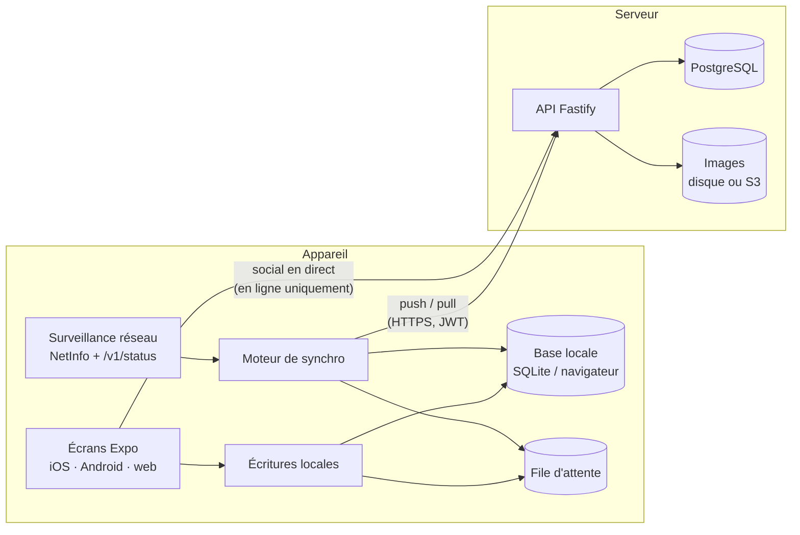

# Architecture

## Vue d'ensemble

**Principe : hors ligne d'abord.** L'écran lit et écrit toujours la base locale de l'appareil. Le serveur sert à
synchroniser plusieurs appareils, à sauvegarder et à faire fonctionner les fonctions sociales.

| Situation | Objectifs, validations, séries | Feed, amis, stories, messages | Synchronisation |
| --- | --- | --- | --- |
| Compte + en ligne | ✓ | ✓ | automatique (au démarrage, au retour au premier plan, chaque minute) |
| Compte + hors ligne | ✓ (base locale) | masqués temporairement | file d'attente, envoyée au retour de la connexion |
| Sans compte | ✓ (base locale) | indisponibles | indisponible ; tout est conservé si un compte est créé plus tard |
| Maintenance sociale | ✓ | lecture seule | ✓ |
| Maintenance complète | ✓ (base locale) | masqués | suspendue (le serveur répond 503) |

## Choix techniques

| Élément | Choix | Pourquoi |
| --- | --- | --- |
| App | Expo SDK 51 + expo-router | Une seule base de code pour iOS, Android et web ; builds et publication via EAS |
| Base locale | expo-sqlite (mobile), stockage navigateur (web) | Même interface `LocalStore`, choisie automatiquement par Metro (`local.ts` / `local.web.ts`) |
| Réseau | @react-native-community/netinfo + `GET /v1/status` | Distingue « pas d'internet » de « serveur injoignable » ou « en maintenance » |
| Jetons | expo-secure-store (Keychain / Keystore) | Les jetons ne sont jamais stockés en clair sur mobile |
| API | Fastify 4 + zod | Rapide, validation stricte de chaque entrée, schémas partagés avec l'app |
| Base serveur | PostgreSQL 16 ; schéma et migrations avec Drizzle | Transactions, séquence de révision pour la synchro, suppressions en cascade (RGPD) |
| Requêtes | postgres.js (requêtes paramétrées) | Pas d'injection SQL possible ; requêtes lisibles |
| Mots de passe | bcrypt (12 tours) | Standard éprouvé ; temps constant même si le compte n'existe pas |
| Sessions | JWT d'accès 15 min + jeton de renouvellement 30 j, à usage unique | Un jeton volé et réutilisé révoque toutes les sessions du compte |

## Modèle de données (PostgreSQL)

- **Personnel, synchronisé** : `goals` (14 types, réglages propres au type dans `data`), `checkins`, `goal_groups`, réglages du compte (`users.settings`).
  Chaque ligne porte `rev` (séquence `sync_rev_seq`) et `deleted_at` (suppression transmise aux autres appareils).
- **Partagé** : `goal_members` (défis de groupe et duels), binôme de motivation (`goals.buddy_id`, validations `pending`).
- **Social** : `friendships`, `blocks`, `posts`, `post_likes`, `cheer_credits` (gels de série), `comments`, `stories` (expirent après 24 h), `story_views`, `messages` (chiffrés de bout en bout, colonne `e2e` ; seul PepsGoal Officiel écrit en clair), `e2e_devices`, `e2e_pair_keys`, `e2e_envelopes` (voir E2E.md), `notifications`.
- **Modération** : `reports`, `appeals`, `mod_actions` (journal), `maintenance`, `announcements` ; colonnes de sanction sur `users` (`warned_at`, `ban_until`, `ban_permanent`, `comments_restricted`).

Les types d'objectifs et leurs réglages sont définis une seule fois dans `packages/shared/src/schemas.ts` (`GoalDataByType`)
et validés à l'identique par le serveur et l'app.

## Sécurité

- Chaque entrée est validée par un schéma zod ; les données inconnues sont refusées (`invalid`).
- Les points sont plafonnés côté serveur (`POINTS` du type + 200 de bonus maximum) : un client modifié ne peut pas gonfler les classements.
- Un objectif ne peut être modifié que par son propriétaire ; un membre ne voit que les défis auxquels il participe.
- Images : 8 Mo maximum, type vérifié par la signature du fichier (JPEG, PNG, WebP), nom aléatoire ; seules les images du serveur sont acceptées comme avatar ou story.
- Limitation de débit globale (300 requêtes/min) et renforcée sur la connexion, l'inscription, la publication et les signalements.
- Comptes bannis : écriture sociale refusée, mais leurs objectifs restent synchronisés.
- Blocage entre utilisateurs (`POST /v1/users/:id/block`) : exigé par les stores pour toute app avec contenus d'utilisateurs.
- Suppression de compte depuis l'app (`DELETE /v1/me`) : exigée par Apple et Google ; supprime toutes les données en cascade.

## Écrans à porter depuis le prototype

L'app couvre aujourd'hui : connexion, inscription, mode sans compte, création d'un compte depuis le mode sans compte,
aujourd'hui (validation hors ligne + série), objectifs (routine et abstinence), feed, amis, messagerie chiffrée de bout en bout, profil
(état de la synchronisation), modération (vue d'ensemble, publications à valider, signalements).

À porter depuis `apps/web-legacy/pepsgoal.html`, dans cet ordre conseillé :
1. Formulaires des 12 autres types (limite, durée + minuteur, mesure + courbe, horaire, projet, challenge, paliers, mensuel, objectif chiffré, deadline, défi de groupe, duel).
2. Fiche objectif (calendrier, historique, groupes d'objectifs), flammes, niveaux, gels de série, badges.
3. Stories (création et lecture), conversation complète, commentaires, notifications.
4. Récaps semaine / mois / année, journée parfaite, animations.
5. Paramètres (apparence, rappels via expo-notifications, données, aide et documents légaux), import / export .zip.
6. Modération complète : comptes, contestations, maintenances, annonces PepsGoal Officiel.

## Interface (app iOS, Android et web)

L'app reprend le design du prototype web (`apps/web-legacy/pepsgoal.html`). Les mêmes composants servent sur iOS, Android et le navigateur.

| Élément | Fichier | Contenu |
| --- | --- | --- |
| Thème | `apps/app/src/ui/theme.tsx` | Couleurs claires et sombres, halos, 12 accents, couleurs des 14 types d'objectifs, palette daltonienne, contraste élevé. Le thème et l'accent sont des réglages synchronisés. |
| Composants | `apps/app/src/ui/kit.tsx` | Panneaux vitrés, boutons en dégradé, puces de type, flamme, anneau de progression, avatars, barre du haut, bandeaux d'état, dialogues compatibles web (`ask` et `tell`). |
| Pictogrammes | `apps/app/src/ui/icons.ts` | Tracés de l'objet `P` du prototype, rendus en SVG natif. |
| Logique d'affichage | `apps/app/src/ui/goals.ts` | Niveaux de flammes, objectifs du jour, lignes d'information, semaine en cours. |
| Navigation | `apps/app/app/(tabs)/_layout.tsx` | Grand écran (860 px et plus) : barre latérale vitrée. Mobile : barre d'onglets flottante et bouton « + ». |

Polices : Unbounded pour les titres et les chiffres, Manrope pour le texte, chargées au démarrage par `expo-font`.
Pour garder l'app et le prototype alignés, toute nouvelle couleur ou tout nouveau composant s'ajoute d'abord à `theme.tsx` ou `kit.tsx`.
