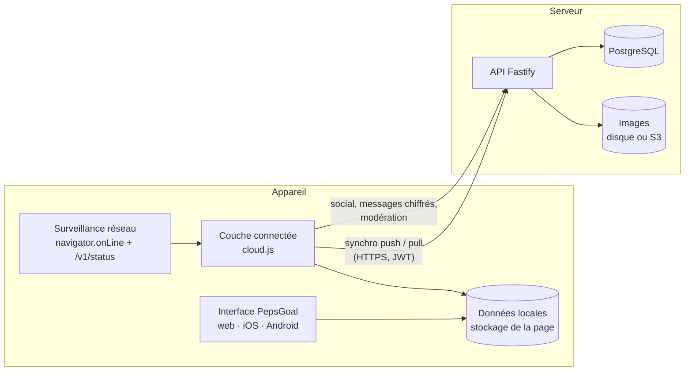

# Architecture

## Vue d'ensemble

**Principe : hors ligne d'abord.** L'écran lit et écrit toujours la base locale de l'appareil. Le serveur sert à
synchroniser plusieurs appareils, à sauvegarder et à faire fonctionner les fonctions sociales.

| Situation | Objectifs, validations, séries | Feed, amis, stories, messages | Synchronisation |
| --- | --- | --- | --- |
| Compte + en ligne | ✓ | ✓ | automatique (au démarrage, au retour au premier plan, chaque minute) |
| Compte + hors ligne | ✓ (base locale) | masqués temporairement | file d'attente, envoyée au retour de la connexion |
| Sans compte | ✓ (base locale) | indisponibles | indisponible ; tout est conservé si un compte est créé plus tard |
| Maintenance sociale | ✓ | lecture seule | ✓ |
| Maintenance complète | ✓ (base locale) | masqués | suspendue (le serveur répond 503) |

## Choix techniques

| Élément | Choix | Pourquoi |
| --- | --- | --- |
| Interface | `apps/web-legacy/pepsgoal.html` (HTML, CSS et JavaScript sans framework) | Une seule interface, identique sur le web, iOS et Android |
| Couche connectée | `apps/web/src/cloud.js` | Branche l'interface sur le serveur sans la modifier : comptes, synchro, social, messages chiffrés, modération |
| App mobile | Expo SDK 51 + react-native-webview | Coque native qui embarque l'interface (hors ligne) ; builds et publication via EAS |
| Données locales | stockage de la page (`localStorage`, origine `https://app.pepsgoal.fr`) | Même format que le prototype ; fonctionne sans connexion |
| Réseau | `navigator.onLine` + `GET /v1/status` (nouvel essai à 5 s, 10 s, 20 s, 40 s puis chaque minute) | Distingue « pas d'internet » de « serveur injoignable » ou « en maintenance » |
| Jetons | stockage de la page, jeton de renouvellement à usage unique | Un jeton volé et réutilisé révoque toutes les sessions du compte |
| API | Fastify 4 + zod | Rapide, validation stricte de chaque entrée, schémas partagés avec l'app |
| Base serveur | PostgreSQL 16 ; schéma et migrations avec Drizzle | Transactions, séquence de révision pour la synchro, suppressions en cascade (RGPD) |
| Requêtes | postgres.js (requêtes paramétrées) | Pas d'injection SQL possible ; requêtes lisibles |
| Mots de passe | bcrypt (12 tours) | Standard éprouvé ; temps constant même si le compte n'existe pas |
| Sessions | JWT d'accès 15 min + jeton de renouvellement 30 j, à usage unique | Un jeton volé et réutilisé révoque toutes les sessions du compte |

## Modèle de données (PostgreSQL)

- **Personnel, synchronisé** : `goals` (14 types, réglages propres au type dans `data`), `checkins`, `goal_groups`, réglages du compte (`users.settings`).
  Chaque ligne porte `rev` (séquence `sync_rev_seq`) et `deleted_at` (suppression transmise aux autres appareils).
- **Partagé** : `goal_members` (défis de groupe et duels), binôme de motivation (`goals.buddy_id`, validations `pending`).
- **Messagerie** : `messages` (privé : `recipient_id`, groupe : `group_id`, pièces jointes citées : `attachments`), `chat_groups`, `chat_group_members`, `attachments` (fichiers chiffrés, jamais servis publiquement).
- **Social** : `friendships`, `blocks`, `posts` (photo : `photo_url`, sondage : `poll`), `poll_votes`, `post_likes`, `cheer_credits` (gels de série), `comments`, `stories` (24 h en ligne, puis archive personnelle d'un an), `story_views`, `story_likes`, `messages` (chiffrés de bout en bout, colonne `e2e` ; seul PepsGoal Officiel écrit en clair), `e2e_devices`, `e2e_pair_keys`, `e2e_envelopes`, `e2e_vaults` (clé du coffre chiffrée, témoins), `e2e_vault_keys` (voir E2E.md), `notifications`, `push_subscriptions` (navigateurs abonnés aux notifications push), `reminder_pushes` (rappels déjà envoyés), `app_settings` (clés VAPID générées au premier démarrage).
- **Modération** : `reports`, `appeals`, `mod_actions` (journal), `maintenance`, `announcements` ; colonnes de sanction sur `users` (`warned_at`, `ban_until`, `ban_permanent`, `comments_restricted`).

Les types d'objectifs et leurs réglages sont définis une seule fois dans `packages/shared/src/schemas.ts` (`GoalDataByType`)
et validés à l'identique par le serveur et l'app.

## Sécurité

- Chaque entrée est validée par un schéma zod ; les données inconnues sont refusées (`invalid`).
- Les points sont plafonnés côté serveur (`POINTS` du type + 200 de bonus maximum) : un client modifié ne peut pas gonfler les classements.
- Un objectif ne peut être modifié que par son propriétaire ; un membre ne voit que les défis auxquels il participe.
- Images : 8 Mo maximum, type vérifié par la signature du fichier (JPEG, PNG, WebP), nom aléatoire ; seules les images du serveur sont acceptées comme avatar ou story.
- Limitation de débit globale (300 requêtes/min) et renforcée sur la connexion, l'inscription, la publication et les signalements.
- Comptes bannis : écriture sociale refusée, mais leurs objectifs restent synchronisés.
- Blocage entre utilisateurs (`POST /v1/users/:id/block`) : exigé par les stores pour toute app avec contenus d'utilisateurs.
- Suppression de compte depuis l'app (`DELETE /v1/me`) : exigée par Apple et Google ; supprime toutes les données en cascade.

## Interface (web, iOS et Android)

Toute l'interface est celle du prototype, sans réécriture : `apps/web-legacy/pepsgoal.html` est la référence unique
(écrans, animations, 14 types d'objectifs, flammes, gels, récaps, stories, messagerie, modération, paramètres, accessibilité, documents légaux).

| Élément | Fichier | Rôle |
| --- | --- | --- |
| Interface | `apps/web-legacy/pepsgoal.html` | Tous les écrans. Seuls quelques points d'accroche y ont été ajoutés (démarrage, identifiants UUID), inactifs sans serveur. |
| Couche connectée | `apps/web/src/cloud.js` | Chargée avant l'interface ; remplace certaines fonctions (enregistrement, validations, actions sociales et de modération) par des appels à l'API. Ne fait rien si aucune API n'est configurée. |
| Emojis | `apps/web/emoji/` | Emojis Fluent de Microsoft (licence MIT) en WebP 96 px, générés par `apps/web/scripts/fluent-emoji.mjs` ; chaque emoji affiché par l'interface est remplacé par son image, les champs de saisie gardent ceux du système. |
| Construction | `apps/web/build.mjs` | Assemble interface + couche connectée + tweetnacl + JSZip + polices locales (Unbounded, Manrope) + emojis Fluent. Produit `apps/web/dist/` (web) et `apps/app/src/webapp.generated.ts` (mobile, un seul fichier). |
| App mobile | `apps/app/App.tsx` | WebView plein écran, bouton retour Android, liens externes, partage des fichiers exportés, zones sûres. |

Fonctionnement de la couche connectée :
- **Synchro** : l'état connu du serveur est mémorisé ; à chaque enregistrement, les différences (objectifs, validations, réglages) partent vers `/v1/sync/push`, puis `/v1/sync/pull` récupère les changements des autres appareils (le plus récent gagne).
- **Social** : amis, feed, stories, notifications et conversations sont relus depuis le serveur (au démarrage, en changeant d'onglet, chaque minute ; la conversation ouverte toutes les 8 s).
- **Messagerie** : texte, photos, messages vocaux et objectifs partagés, en privé ou en groupe, chiffrés de bout en bout (voir E2E.md).
- **Modération par e-mail** : chaque signalement, publication à valider ou demande de débannissement déclenche aussi un e-mail à `MOD_EMAIL` (`apps/server/src/lib/mailer.ts`).
- **Notifications push** : la version web enregistre un service worker (`/sw.js`, `apps/web/public/sw.js`) et abonne le navigateur via Web Push (`apps/server/src/lib/push.ts`). Le serveur envoie les rappels (toutes les 5 minutes, il vérifie qui doit en recevoir), les messages et les notifications, même application fermée. Dans les applications iOS/Android (WebView), Web Push n'existe pas : les rappels restent affichés dans l'application.
- **Objectif Période** : `type: 'period'`, `data: { freq: 'week'|'month', days, mdays, start, end }` ; le serveur envoie un rappel push au début de chaque période (`sendReminders`, chaque minute).
- **Météo et thème Météo** : `apps/server/src/lib/weather.ts` relaie Open-Meteo avec un cache ; la ville est gardée dans `extra.weather`. Le thème Météo (`theme: 'weather'`) dessine le ciel (calque `.bg-sky` : dégradé selon l'heure et le temps, soleil, lune, étoiles, nuages, pluie, neige, orage, brouillard) et passe en clair le jour, en sombre la nuit, avec des panneaux en verre givré.
- **Arrière-plans** : Blob, Aurore, Vagues, Constellation, Dégradé, Grille, Uni (calques CSS de `.backdrop`, couleurs de l'accent) ou image personnalisée, gardée sur l'appareil (`localStorage`, JPEG redimensionné) ; ses couleurs dominantes sont extraites sur l'appareil (histogramme de teintes) et peuvent devenir l'accent (`extra.accentCustom`, trois nuances calculées pour rester lisibles).
- **Easter eggs** : couleur Soleil → titre « PepsGold », Glacier → « PepsCold » avec de la neige ; le 1er avril, PepsGoal Officiel envoie « test cedric » à chaque compte (`apps/server/src/lib/eggs.ts`, une fois par compte, avec les rappels).
- **Suggestions d'amis** : calculées par le serveur (`GET /v1/friends/suggestions`), masquables une par une (`extra.hiddenSuggest`) ; chacun peut refuser d'y apparaître (`extra.noSuggest`).
- **Onglet Serveur (modération)** : `GET /v1/admin/stats` (`apps/server/src/lib/metrics.ts`) ; le trafic est compté en mémoire par un crochet `onResponse` de Fastify (remis à zéro au redémarrage).
- **Badges** : 12 familles à paliers (Bronze, Argent, Or, Platine, Diamant) calculées sur l'appareil à partir des données synchronisées ; les badges déjà célébrés sont gardés dans les réglages (`extra.badges`) pour ne pas être fêtés deux fois.
- **Hors ligne** : l'interface continue de fonctionner (aussi à la demande : Paramètres › Données › Mode hors ligne, aucun appel au serveur) ; la déconnexion et le changement de compte sont bloqués tant que le serveur n'a pas confirmé la synchronisation.
- **Sans compte** : l'interface fonctionne comme le prototype, entièrement sur l'appareil ; créer un compte envoie ensuite toutes les données.

Pour modifier l'interface : éditer `apps/web-legacy/pepsgoal.html`, puis `npm run build:web` (web) ; l'app mobile est reconstruite automatiquement par EAS.
L'ancienne réécriture React Native est conservée dans `archive/app-react-native/` pour référence ; elle n'est plus utilisée.
